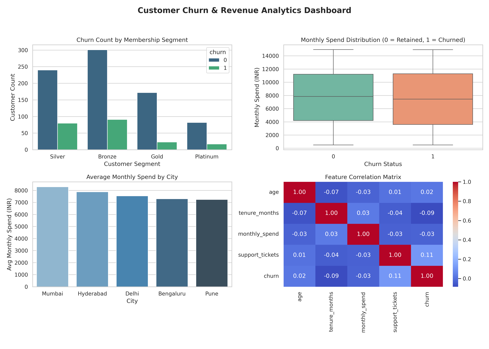

# Customer Churn & Revenue Analytics — Data Engineering Capstone Project

**Submitted By:** Shruti Gupta  
**Roll Number:** 2601201028  
**GitHub Profile:** sshrutiigupta36-web  

## Project Overview
This capstone project implements a data engineering, visual analytics, and machine learning workflow for Retail Customer Churn & Revenue Analytics. It processes raw customer records into cleaned and ML-ready datasets alongside a Scikit-Learn pipeline and MLflow experiment tracking.

**Note on Dataset:** The dataset used in this project is **synthetic** and was generated for simulation and capstone demonstration purposes.

## Repository Structure
<pre>
Customer-Churn-Analytics-Capstone/
├── data/
│   ├── raw_data.csv             # Raw ingested customer records
│   └── ml_ready_data.csv        # Cleaned, imputed, scaled & one-hot encoded ML-ready dataset
├── models/
│   └── trained_pipeline.pkl     # Exported Scikit-Learn ColumnTransformer + Random Forest pipeline
├── notebooks/
│   └── Customer_Churn_Analytics_Capstone.ipynb  # Complete executable workflow notebook
├── screenshots/
│   └── analytics_dashboard.png  # 4-panel EDA & analytics dashboard
├── requirements.txt             # Python dependencies
└── README.md                    # Project documentation & execution instructions
</pre>

## Analytics Dashboard

## Key Workflow Stages
1. **Data Acquisition & Cleaning:** Loads raw customer records, removes exact duplicates, and applies median imputation for numerical features and mode imputation for categorical attributes.
2. **Exploratory Data Analysis (EDA) & Dashboards:** Visualizes segment churn counts, monthly spend distributions, city-wise average spend, and feature correlations.
3. **Feature Engineering & Pipeline:** Creates features (`spend_per_month_tenure`, `high_ticket_flag`) and uses `ColumnTransformer`, `SelectKBest`, and `RandomForestClassifier`.
4. **Experiment Tracking & Model Export:** Logs parameters, metrics, and artifacts via MLflow (`Retail_Churn_Capstone_Experiment`, run `RandomForest_Pipeline_v1`) and saves the pipeline with Joblib.
5. **Inference Testing:** Reloads `models/trained_pipeline.pkl` and tests predictions on sample rows.

## How to Execute
1. Clone the repository: (git clone https://github.com/sshrutiigupta36-web/Customer-Churn-Analytics-Capstone.git)
2. Install required dependencies: (pip install -r requirements.txt)
3. Open and run (notebooks/Customer_Churn_Analytics_Capstone.ipynb) in Google Colab or Jupyter Notebook.
